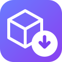

# 3D-Mesh-Downloader

<p align="center">
  
</p>

Extensão Chrome (Manifest V3) que **exporta a cena 3D de qualquer página** —
em `.obj` (+ `.mtl`) ou convertida direto para `.stl`.

Não é um "download de assets": ela intercepta a cena Three.js que está sendo renderizada
na página e reconstrói a geometria (posição, normais, UVs, materiais e transformações de
objeto) em um arquivo Wavefront OBJ — ou em STL, pronto para impressão 3D.

- Extração da cena Three.js com aplicação de `matrixWorld`
- Normais, UVs e materiais (`.mtl`) preservados
- `InstancedMesh` expandido, `SkinnedMesh` na pose deformada
- **STL binário ou ASCII** convertido no navegador (o `.obj` nunca é criado)
- Filtro por **nome** e por **tamanho**, com seleção explícita por modelo
- **Lista de exclusão** persistente (o que não deve entrar no arquivo)
- **Gerador de chaveiros com nome** (`nomes.html`): prévia 3D, parâmetros e STL,
  partindo do mesmo desenho do `nomes.scad`

Arquitetura e decisões de projeto: [docs/DESIGN.md](docs/DESIGN.md).

---

## Instalação

### Como extensão descompactada (desenvolvimento)

```bash
npm run build
```

Depois:

1. Abra `chrome://extensions`
2. Ative **Modo do desenvolvedor**
3. Clique em **Carregar sem compactação** e escolha a pasta `dist/`

### Empacotar como `.crx` (para distribuir)

O próprio Chrome gera o pacote assinado:

```bash
"C:\Program Files\Google\Chrome\Application\chrome.exe" --pack-extension=D:\Projetos\3d-mesh-downloader\dist
```

O Chrome cria `dist.crx` e `dist.pem` (guarde o `.pem` — é a chave que mantém o ID fixo).

### Publicar na Chrome Web Store

`npm run build` gera `release/3d-mesh-downloader-<versão>.zip` com o `manifest.json` na raiz,
pronto para upload no [Painel do Desenvolvedor](https://chrome.google.com/webstore/devconsole).

---

## Uso

1. Abra uma página que renderiza 3D com Three.js
2. Clique no ícone da extensão → o contador mostra quantas malhas foram capturadas
3. Ajuste as opções e clique em **Baixar malhas**
4. Os arquivos `.obj` (e `.mtl`) caem na pasta de downloads

O popup é dividido em **abas**, no estilo do Chrome:

| Aba | O que fica lá |
|---|---|
| **Modelos** | contador, filtro por nome e tamanho, atalhos de seleção e a lista de malhas |
| **Exclusão** | padrões que nunca entram no arquivo e a prévia do que está sendo excluído |
| **Exportar** | formato (OBJ/STL) e as opções de exportação |
| **Nomes** | abre o gerador de chaveiros com o nome (página inteira, com prévia 3D e STL) |

O botão **Baixar** e o **Atualizar contagem** ficam na aba **Modelos**, junto da
lista; as outras abas cuidam só de configuração. A barra de status continua
visível em qualquer aba. O badge de cada aba resume o estado (malhas
selecionadas, padrões ativos) e a última aba usada é restaurada ao reabrir o
popup. Teclado: `←`/`→` alternam e `1`/`2`/`3`/`4` saltam.

**Tudo o que você configura fica salvo** em `chrome.storage.local`: formato,
opções de exportação, padrões de exclusão, regra de tamanho e a aba ativa.
Fechar e reabrir o popup não volta nada ao padrão.

> A extensão só captura cenas **construídas depois** que ela é injetada. Se o contador
> ficar em `0`, recarregue a página (F5).

### Lista de exclusao

Uma lista de padrões de nome que **nunca** entram no arquivo exportado. Ela fica
salva em `chrome.storage.local`, então sobrevive ao fechar o popup e ao
reiniciar o navegador — é o lembrete do que não deve ser capturado.

| Padrão | Casa com |
|---|---|
| `X*` | `X`, `X_1`, `X_2`, `XY`, `XYZ`… (a família inteira) |
| `X_*` | só os que exportam como `X_1`, `X_2` |
| `X_1` | exatamente o segundo `X` |
| `X?` | `X` + exatamente um caractere |
| `cube` | só o modelo chamado `cube` (sem curinga = nome exato) |

O padrão é testado contra o nome original da malha, o nome que ela recebe no
arquivo exportado (`X_1`, quando vários modelos têm o mesmo nome) e esse
nome sem o sufixo.

### Exclusão por tamanho

A aba Exclusão tem **duas listas independentes**:

| Lista | Guarda | Como entra |
|---|---|---|
| **Por nome** | padrões com curinga (`X*`, `skeleton-*`) | você digita e clica em **Add** |
| **Por tamanho** | nomes concretos (o nome de exportação de cada malha) | escolhe o critério e clica em **Adicionar** |

A lista por tamanho é **materializada**: os nomes entram **uma vez** e ficam.
Não há reavaliação a cada consulta da página, então a lista não fica alternando
entre excluído e não-excluído. Na primeira vez o popup monta a lista sozinho;
depois disso, use **Adicionar** para pegar malhas novas.

O critério é aplicado sobre o **tamanho estimado no formato escolhido** na aba
Exportar — o mesmo número que aparece na lista.

> O padrão é **menor que 50 KB**: descarta os gizmos e helpers pequenos. No
> Tripo isso costuma ser a maior parte da cena (79 malhas → 66 pequenas,
> sobrando 13). Para o contrário, troque para **maior que**.

O `×` de um nome devolve aquele modelo; o `↺` na lista de modelos faz o mesmo.
Cada nome usa o **nome de exportação** (`X_1`, `X_2`…), que é único por malha —
assim um modelo grande com nome repetido não cai junto com um pequeno homônimo.

Os excluídos vão para o **fim da lista**, atrás de um separador `EXCLUÍDAS` — a
fila de exportação fica sempre no topo. Esse bloco tem **rolagem própria**, e a
prévia da aba Exclusão também: dá para percorrer os nomes sem arrastar a lista
inteira. Eles aparecem esmaçados e riscados, com o checkbox desabilitado; o
botão `⊘` exclui um modelo rápido (adicionando o nome exato) e o `↺` desfaz. A
exclusão tem **prioridade sobre a seleção**: um modelo excluído nunca entra no
arquivo, mesmo que esteja marcado.

No modelo real do Tripo (68 malhas, ~50 delas são gizmos do editor):

| Padrões | malhas | faces |
|---|---|---|
| — | 68 | 352.853 |
| `X_*`, `skeleton-*` | 55 | 351.801 |
| `X*`, `Y*`, `Z*`, `skeleton-*` | **12** | 349.673 |

### Formatos de saída

O seletor **Formato do arquivo** no popup escolhe o que é gravado. O padrão é
**STL binário** — é o que a maioria quer (impressão 3D) e evita o `.obj` gigante
com `.mtl` ao lado:

| Formato | O que acontece |
|---|---|
| **STL binário** *(padrão)* | A geometria é convertida **no navegador** e o `.stl` é gravado direto — o `.obj` nunca é criado |
| **OBJ (+ .mtl)** | `.obj` com `v`/`vt`/`vn`/`f` + `.mtl` com materiais, cores e texturas referenciadas |
| **STL ASCII** | Igual ao binário, mas em texto (legível, ~40% maior) |

A conversão STL acontece dentro da página, em memória:

- todos os modelos são fundidos em uma **sopa de triângulos** (STL é malha única);
- cada facet recebe a **normal calculada a partir dos seus três vértices**
  (STL não guarda normal por vértice);
- **triângulos degenerados** (área zero) são descartados;
- o arquivo binário sai com o layout padrão: 80 bytes de cabeçalho + contagem de
  4 bytes + 50 bytes por facet.

O tamanho estimado de cada modelo no filtro também acompanha o formato escolhido
(`84 + 50 × triângulos` para o STL binário), então filtrar por KB faz sentido em
qualquer formato.

No modelo real do Tripo (352.853 faces): **OBJ 36,5 MB → STL 16,8 MB**.

### Opções de exportação

| Opção | Padrão | Efeito |
|---|---|---|
| Aplicar transformações do objeto | ligado | Exporta em espaço de mundo (`matrixWorld`), com posição/rotação/escala |
| Exportar normais (`vn`) | ligado | Usa o atributo de normal; se faltar, calcula normal planar e expande os vértices |
| Exportar UVs (`vt`) | ligado | Exporta o atributo `uv` quando existir |
| Expandir `InstancedMesh` | ligado | Uma malha por instância, aplicando a matriz de cada uma |
| Exportar materiais (`.mtl`) | ligado | Gera `newmtl`, `Kd`, `Pr`, `Pm` e `map_Kd` |

Cada malha vira **um arquivo**: um `.stl` por malha, ou um `.obj` + `.mtl`.
Se o Chrome perguntar se pode baixar vários arquivos, clique em **Permitir**.

### Filtro por nome e por tamanho

O popup lista **cada malha encontrada** com nome, vértices, faces e tamanho estimado,
e permite filtrar antes de exportar:

| Controle | Efeito |
|---|---|
| Campo de texto | Casa o nome do modelo, o nome da cena e o nome do material (case-insensitive) |
| `min KB` / `max KB` | Filtra pelo tamanho estimado do `.obj` que a malha produziria |
| Checkbox por modelo | Seleção explícita: exporta só o que estiver marcado |
| `Todos` / `Nenhum` / `Só os visíveis` | Atalhos para a seleção |

O filtro é aplicado **no navegador** (no `injected.js`), então o que sai no download
já é o que foi filtrado. As opções chegam ao script da página por `window.postMessage`
e são validadas de novo lá — o popup nunca envia dados do modelo, só uma lista de ids.

Exemplo real (página do Tripo3D, 68 malhas):

| Filtro | Resultado |
|---|---|
| texto `skeleton` | 2 malhas — 360 faces |
| `max 50 KB` | 66 malhas — 3.833 faces |
| `min 5000 KB` | 1 malha — 340.956 faces (34 MB) |
| sem filtro | 68 malhas — 352.853 faces (36,5 MB) |

---

## Gerador de chaveiros com nome

A aba **Nomes** do popup abre o gerador em uma **aba inteira** do navegador
(`nomes.html`) — é o espaço que a prévia 3D e o STL precisam. A lista digitada no
popup vai junto quando você clica em **Abrir com esta lista**.

Cada nome vira um chaveiro de **duas peças**, igual ao `nomes.scad`:

| Peça | O que é |
|---|---|
| **Base** (rosa) | extrusão da silhueta do nome com o **furo** nas pontas |
| **Topo** (branco) | a mesma silhueta, com o **nome vazado**; colado na base, o nome aparece na cor da base |

O furo tem dois modos:

| Furo | Como fica |
|---|---|
| **Ponteiras** (padrão) | o contorno são as letras; em cada ponta entra um **disco** com o furo: diâmetro de entrada (4,5 mm) à esquerda e de saída (3,5 mm) à direita |
| **Túnel** | o contorno é o `hull` do texto (a barra do `.scad`) e o cone atravessa o nome no comprimento, da entrada à saída |

A espessura da base é calculada para sobrar a parede mínima em volta do furo:

```
Base_Thickness = 2 × maior_raio + 2 × parede_mínima
```

### Parâmetros

| Parâmetro | Padrão | Efeito |
|---|---|---|
| Nomes | — | um por linha (vírgula também vale); até 120 por lote |
| Modo | montado | `juntos` (topo em cima da base), `separado` (as duas peças na mesa) ou `ambos` |
| Gerar | base + topo | permite exportar só a base (a "ponteira" com o furo) ou só o topo |
| Fonte | Chewy | a fonte embutida (Apache 2.0) ou qualquer `.ttf` carregado por você |
| Tamanho / Borda | 12 mm / 2 mm | altura do texto (mínimo 12 mm) e o offset em volta das letras |
| Furo | ponteiras | `ponteiras` (disco em cada ponta) ou `túnel` (cone no comprimento) |
| Furo entrada / saída | 4,5 / 3,5 mm | diâmetro do disco da esquerda e da direita (ou os raios do cone, no modo túnel) |
| Parede mínima | 1,6 mm | parede em volta do furo |
| Topo | 1,5 mm | espessura da peça branca |
| Colunas / Espaço X / Y | 4 / 60 / 40 mm | grade da mesa |
| Dist. separado / ambos | 40 / 45 mm | afastamento entre as peças |
| Qualidade | 0,15 mm | passo da malha (0,30 rápida … 0,07 muito alta) |

A prévia é um rasterizador próprio (sem three.js): arraste para girar, roda para
o zoom, dois cliques para reenquadrar, e os botões **Perspectiva / Topo / Frente**.
As cores da prévia também são configuráveis.

### Exportar

- **STL** — um arquivo com todas as peças já posicionadas na grade, em milímetros.
  A malha é fechada (cada aresta pertence a exatamente dois triângulos), o que
  evita furos no fatiador. Com **um STL por nome** marcado, sai um arquivo por
  chaveiro (até 20 de uma vez).
- **`.scad`** — o mesmo desenho como código-fonte para abrir no OpenSCAD.

### Diferenças em relação ao `nomes.scad`

O gerador usa a **largura real do texto** (medida nos contornos do glifo) em vez
da estimativa `len(nome) × tamanho × 0,75` do `.scad`, então o furo cai sempre
dentro do material e o texto pode ter qualquer largura.

No modo **túnel**, o contorno é o mesmo do `.scad` (texto ∪ ponte ∩ `hull`),
acrescido de uma **guarda** de ~1 mm junto às duas pontas: ela deixa a ponta reta
e mantém parede dos dois lados do cone. Sem ela o cone escapa pela lateral das
letras perto das pontas (é o que acontece no `.scad`, cuja parede lateral chega a
ficar com menos de 1 mm).

No modo **ponteiras**, o contorno são as letras e cada ponta recebe um disco com
o furo do seu lado — é o que fecha a ponta direita no diâmetro menor.

---

## Arquitetura

```
popup.js  ──chrome.tabs.sendMessage──▶  content.js (contexto isolado)
                                            │ window.postMessage
                                            ▼
                                          injected.js (world: MAIN, document_start)
                                            │ hooks do three.js
                                            ▼
                              cena capturada → .obj (+ .mtl)
```

| Arquivo | Papel |
|---|---|
| `src/injected.js` | Roda no contexto da página. Instala os hooks, percorre o grafo de cena e escreve o OBJ |
| `src/content.js` | Ponte isolada ↔ página. Não toca em dados da página |
| `src/background.js` | Service worker: localiza a aba alvo de um deep link sem a permissao `tabs` |
| `src/popup.html` / `src/popup.js` | Interface: contador, opções, disparo do download |
| `src/nomes.html` / `src/nomes.js` | Gerador de chaveiros: formulário, prévia 3D e exportação |
| `src/nomes/font.js` | Leitor de fonte TrueType (`cmap`/`loca`/`glyf`) e montagem do texto em contornos |
| `src/nomes/field.js` | Distância assinada, contorno (marching squares), simplificação e triangulação com furos |
| `src/nomes/parts.js` | Base/topo, furo cônico, grade, STL binário e `.scad` |
| `src/nomes/render.js` | Rasterizador 3D em canvas (z-buffer, sombreamento plano, órbita) |
| `src/fonts/` | Fonte Chewy (Apache 2.0) e a licença |
| `src/manifest.json` | MV3, permissão `activeTab`, content scripts em `<all_urls>` |

### Como a cena é capturada

Três camadas de hook, nesta ordem de prioridade:

1. **`window.__THREE_DEVTOOLS__`** — o three.js dispara `CustomEvent('observe')`:
   - `detail = Scene` → cena capturada direto (funciona em **todas** as versões testadas, r150 → r181)
   - `detail = Renderer` → o renderizador é instrumentado
2. **`renderer.render(scene, camera)`** — instrumentado na instância e em
   `THREE.WebGLRenderer.prototype` (builds UMD que expõem `THREE` global).
   É a rede de segurança para builds/frameworks que nunca despacham `observe`.
3. **`window.THREE`** — instalado como *accessor* para que a página não sobrescreva o hook
   silenciosamente; reconferido a cada 500 ms durante os primeiros 15 s.

O `__THREE_DEVTOOLS__` da extensão é instalado como *accessor* (`Object.defineProperty`),
então uma página que defina o próprio valor **não** consegue roubar o hook — o valor da
página é capturado e nossos listeners são anexados a ele.

### Nenhuma dependência do namespace three.js

Toda a matemática de matriz (multiplicação 4×4, aplicação em ponto, *normal matrix*
= transposta da inversa do 3×3) está implementada do zero em `src/injected.js`.
Isso mantém a extensão funcionando em qualquer versão do three.js, inclusive as mais novas.

---

## O que a extensão entrega

| Recurso | Como funciona |
|---|---|
| Transformações | aplicadas via `matrixWorld` (posição/rotação/escala reais no arquivo) |
| Normais | `vn` exportadas; quando a malha não tem atributo de normal, é calculada uma normal planar e os vértices são expandidos |
| UVs | `vt` exportadas quando o atributo existe |
| Materiais | `.mtl` com `newmtl`, `Kd`, `Pr`, `Pm` e `map_Kd` |
| Espaço de cor | convertido de linear (padrão do three.js) para **sRGB** no `.mtl` |
| `InstancedMesh` | uma malha por instância, com a matriz de cada uma |
| `SkinnedMesh` | exportado na pose deformada (skinning recalculado) |
| Nº de downloads | 1 `.obj` + 1 `.mtl` (ou 1 `.stl`) — não esbarra no limite de downloads do Chrome |
| Nome do arquivo | saneado e único (`X`, `X_1`, `X_2`…) |
| `__THREE_DEVTOOLS__` da página | não consegue roubar o hook: é instalado como *accessor* |
| Avisos | status no popup, sem `alert()` |

---

## Testes

### Unitários (Node)

```bash
npm test
```

A suíte roda o `src/injected.js` **real** dentro de um contexto `vm` do Node com DOM
mockado (`test/harness.js`) e cenas Three.js simuladas (`test/mock-three.js`).

Cobre: captura de cena, transformações (com e sem), normais (atributo e planar),
UVs, expansão de instâncias, skinning, materiais, modo por-malha, índices das faces
e robustez (página sem cena, página que define o próprio `__THREE_DEVTOOLS__`).

O gerador de nomes também tem seção própria: leitura da fonte (`cmap`/`glyf`),
contorno por marching squares, triangulação com furos, malha **fechada** das duas
peças (cada aresta em exatamente dois triângulos), volume positivo, STL binário e
o `.scad` exportado.

```
163 passed, 0 failed
```

### Integração (navegador real)

```bash
npm run test:browser
```

Abre `http://127.0.0.1:8731/test/browser-check.html?v=0.180.0`. A página carrega o
**three.js de verdade** do CDN, injeta o `src/injected.js` **antes** dele (como a
extensão faz em `document_start` / `world: MAIN`) e intercepta os downloads para
inspecionar o OBJ gerado — sem gravar nada.

Verificado com sucesso em:

| three.js | build | resultado |
|---|---|---|
| 0.160.0 | `three.module.js` (arquivo único) | 1 cena, 1 malha, 24 v / 24 vn / 24 vt / 12 f |
| 0.171.0 | `three.core.js` + `three.module.js` (a partir do r167) | idem |
| 0.180.0 | `three.core.js` + `three.module.js` | idem |

Nos três casos o primeiro vértice sai em `(8, 22, 32)` - o valor correto para
`BoxGeometry(2,2,2)` com `position (10,20,30)`, `rotation.z = 90°` e `scale 2`,
confirmando a aplicação da `matrixWorld`.

### Pagina de demonstracao local

`test/demo.html` monta uma cena com 9 modelos de nomes e tamanhos diferentes
(caixa, esfera, toro, cilindro, cone, toro-nó detalhado, icosaedro, plano e uma
grade de 40 instancias) e traz um painel com os mesmos filtros do popup, para
testar offline sem depender de nenhum site:

```bash
npm run test:browser
# abre http://127.0.0.1:8731/test/demo.html
```

### Teste em navegador real (Chrome + CDP)
O `tools/` traz um cliente CDP próprio (`tools/cdp.js`), sem dependências, para
dirigir um Chrome real:

```bash
# 1. sobe uma instancia de teste (perfil proprio em .chrome-debug)
powershell -ExecutionPolicy Bypass -File tools\relaunch-debug-chrome.ps1

# 2. dispara uma exportacao e observa os eventos de download
node tools\cdp-download-test.js

# 3. abre o popup real (chrome-extension://.../popup.html), percorre as abas,
#    adiciona um padrao de exclusao e baixa pelo proprio botao
node tools\cdp-popup-test.js
```

O `cdp-popup-test.js` confere o estado das abas (`aria-selected`, painel visível,
badges), a persistência da aba e o download de ponta a ponta, e salva um
screenshot de cada aba em `tools/out/`. Ele recarrega a extensão e a aba alvo,
porque recarregar a extensão orfana o content script já injetado.

> O `--remote-debugging-port` é ignorado pelo Chrome 136+ quando se usa o perfil
> padrão, por isso a instância de teste usa um `--user-data-dir` próprio.
> A extensão é instalada por `Extensions.loadUnpacked` (CDP), já que o Chrome
> de marca ignora `--load-extension`.

Validado em <https://studio.tripo3d.ai/workspace/generate/white-fluffy-dog-with-pink-bow-843c95e3-2c89-4ac4-997c-15a119fd0ea7>
(three.js **r183**, 182.412 vértices / 340.956 faces):

- a extensão capturou **68 malhas em 5 cenas**, e o modelo principal bate
  exatamente com o contador da própria página (182.412 vértices / 340.956 faces);
- a exportação completa gerou um `.obj` de **36,5 MB** (190.427 vértices,
  352.853 faces, 21 materiais) + um `.mtl`;
- os quatro filtros (texto, tamanho mín/máx, seleção explícita) produziram
  exatamente os conjuntos esperados.

Esse teste real encontrou um bug que os testes sintéticos não pegavam — ver
[docs/DESIGN.md](docs/DESIGN.md).

---

## Privacidade

- Nenhuma requisição de rede, nenhum analytics, nenhum dado enviado a lugar nenhum.
- Permissão declarada: apenas `activeTab`. Content scripts em `<all_urls>` (necessário
  para rodar antes do three.js da página).
- O `.obj` gerado fica **no seu disco**; nada sai do navegador.

## Limitações conhecidas

- Apenas Three.js. Other engines (Babylon.js, PlayCanvas) não são suportadas.
- Morph targets são ignorados.
- `WebGPURenderer` não é instrumentado (só expõe `render`, sem `observe`).
- Materiais complexos (shader nodes, PBR completo) viram um `.mtl` simplificado; as
  texturas são apenas **referenciadas por URL**, não baixadas.
